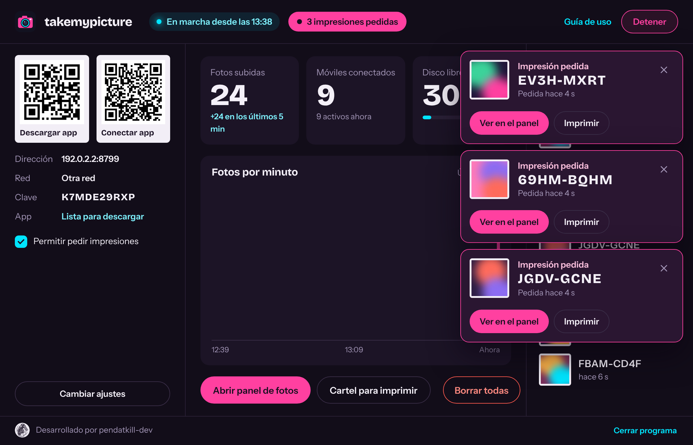
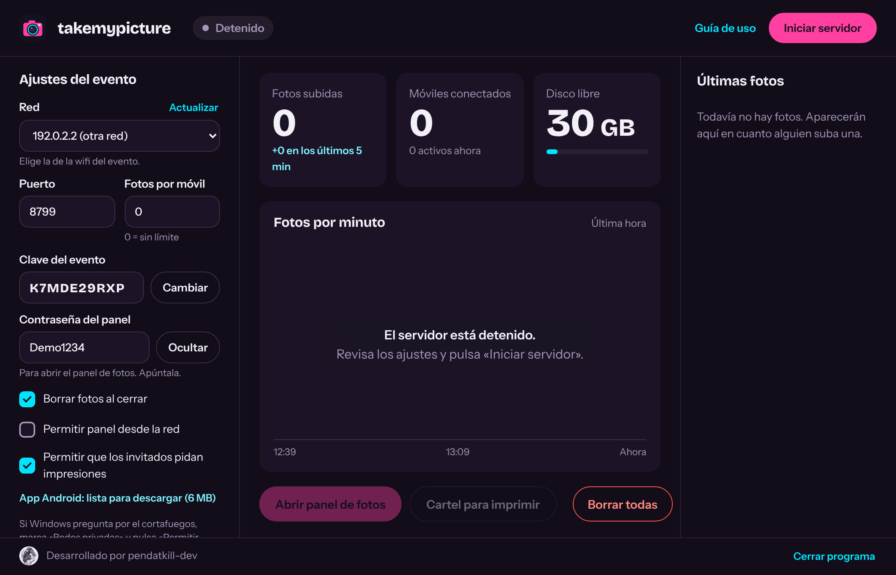
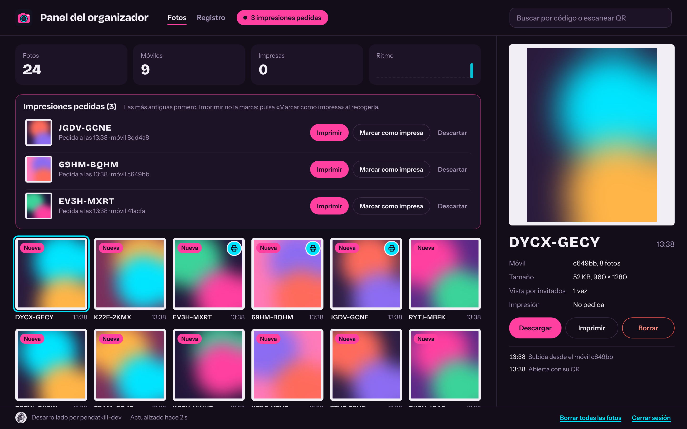
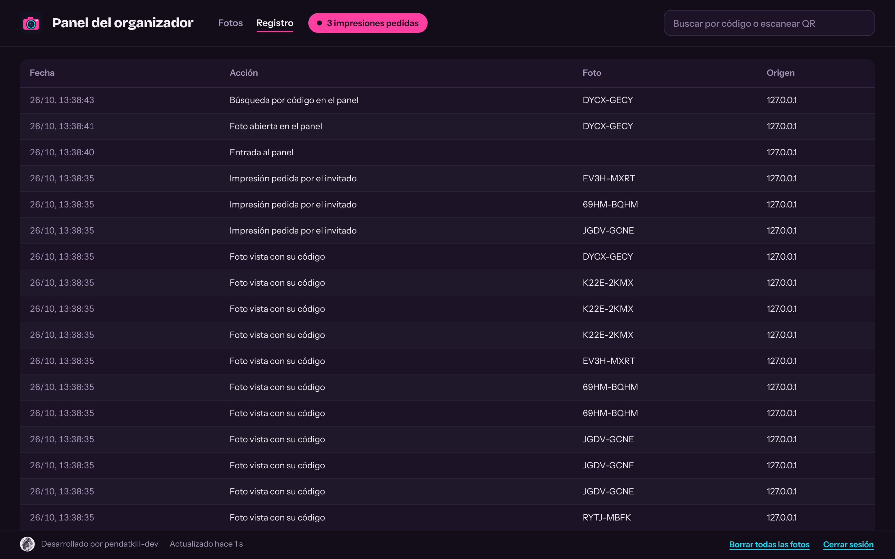
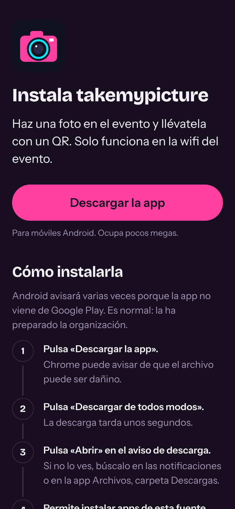
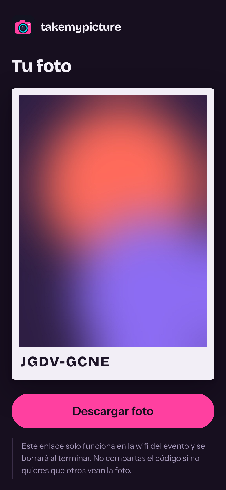
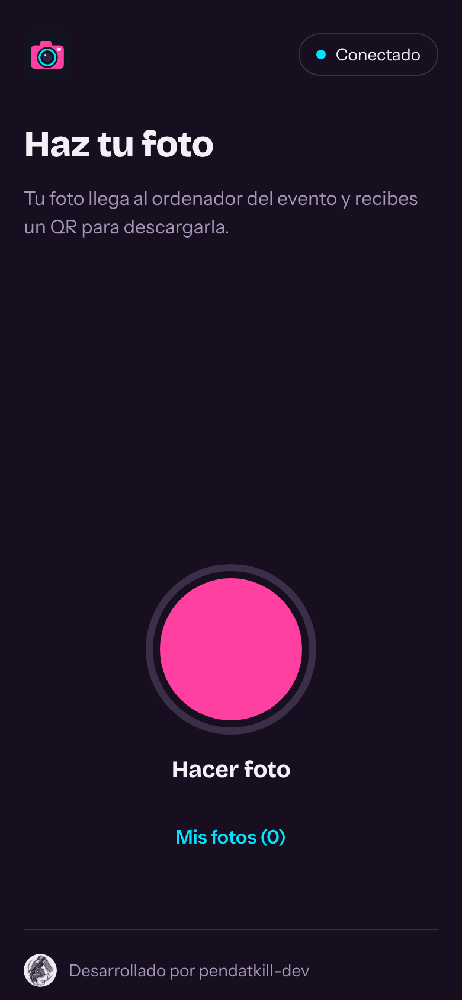
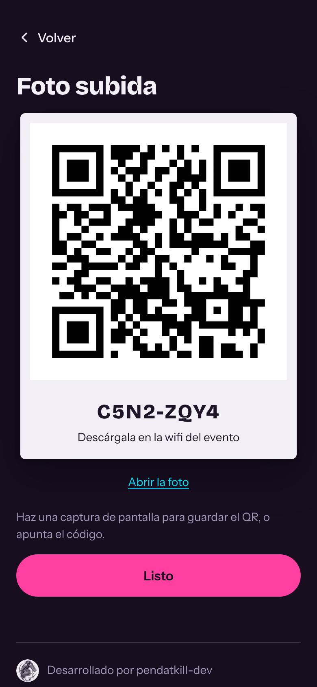
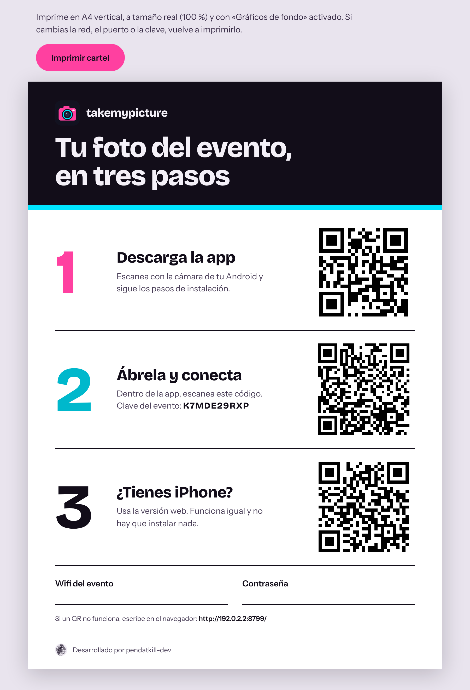

  

<h1 align="center">takemypicture</h1>

  Fotos de evento entregadas por QR, sin internet y sin que salgan del recinto. 
  Programa para Windows + app Android + versión web para iPhone.

---

Los invitados hacen una foto con la app **takemypicture**, la suben al ordenador del evento y reciben un **QR** para descargarla durante el evento. El organizador ve todas las fotos en un panel, puede buscarlas por código, descargarlas, imprimirlas o borrarlas. Las fotos **nunca salen a internet**: viajan por la wifi del evento hasta el ordenador del organizador y se borran al terminar.

## Descarga

La carpeta [`takemypicture-organizador/`](takemypicture-organizador) es todo lo que necesita el organizador:

| Archivo | Para qué sirve |
|---|---|
| `takemypicture-servidor.exe` | El programa. Doble clic y listo, no hay que instalar nada. |
| `Instrucciones de uso.pdf` | Guía paso a paso: red, arranque, carteles, panel e impresiones. |
| `apk/takemypicture.apk` | La app de los invitados. El programa la ofrece desde su página de descarga. |

**Requisitos:** Windows 10 u 11 actualizado (usa Microsoft Edge WebView2, incluido en Windows), una wifi para el evento y, para unas 600 personas, puntos de acceso profesionales. Los invitados necesitan Android 7 o superior; con iPhone usan la versión web.

## Cómo funciona

1. El organizador abre `takemypicture-servidor.exe`, revisa la red propuesta y pulsa **Iniciar servidor**.
2. Imprime el **cartel** con tres QR: descargar la app, conectar la app y versión web para iPhone.
3. El invitado se conecta a la wifi, instala la app, acepta las condiciones y escanea el QR de conexión.
4. Hace una foto y recibe su **QR y un código** (por ejemplo `K7F2-9QXM`). Puede **descargar la foto**, guardar el QR, **pedir que se la impriman** o borrarla.
5. El organizador recibe un **aviso con sonido** por cada impresión pedida y la gestiona desde el panel.

## Capturas

| Consola: configuración | Consola: en marcha con impresiones pedidas |
|---|---|
|  |  |

| Panel del organizador | Registro de actividad |
|---|---|
|  |  |

| Descarga de la app | Foto abierta desde su QR | Versión web: inicio | Versión web: QR de la foto |
|---|---|---|---|
|  |  |  |  |

## Funciones

- **Sin internet ni nube:** servidor local en el ordenador del organizador; descarga solo dentro de la wifi del evento.
- **Consola en directo:** fotos subidas, móviles conectados, fotos por minuto, fotos entrando y aviso de impresiones.
- **Panel del organizador:** cuadrícula de fotos, búsqueda por código o con lector QR por USB, ficha de cada foto, descargar, imprimir, borrar y registro de actividad.
- **Impresiones a petición:** el invitado pide la copia desde la app; el organizador la imprime y la marca como impresa. Se puede **desactivar** («Impresión desactivada por el administrador»).
- **Privacidad:** consentimiento y mayoría de edad obligatorios, se eliminan los datos de ubicación (EXIF/GPS), enlaces imposibles de adivinar, panel solo accesible desde el propio ordenador y borrado total al cerrar.
- **Probado:** más de 270 pruebas automáticas y una prueba de carga simulando 600 invitados (0 % de errores).

## Privacidad y uso responsable

takemypicture está pensado para eventos donde las fotos pueden ser sensibles. El organizador es responsable de:

- verificar la **mayoría de edad** de los asistentes;
- revisar el texto de consentimiento con un asesor (RGPD) antes del evento;
- **no conservar** fotos sin el consentimiento de cada persona;
- borrar todas las fotos al terminar (opción activada por defecto).

Difundir imágenes íntimas sin consentimiento es delito en España (art. 197.7 del Código Penal).

## Licencia

© 2026 Santiago David González Herrera (pendatkill-dev). **Todos los derechos reservados.** No se permite copiar, modificar ni distribuir este software sin autorización escrita del autor. Consulta [`LICENSE`](LICENSE).

Tipografías Bricolage Grotesque e Instrument Sans bajo licencia SIL Open Font License 1.1.

## Créditos

Desarrollado por **pendatkill-dev** · [@pendatkill_dev](https://www.instagram.com/pendatkill_dev)
